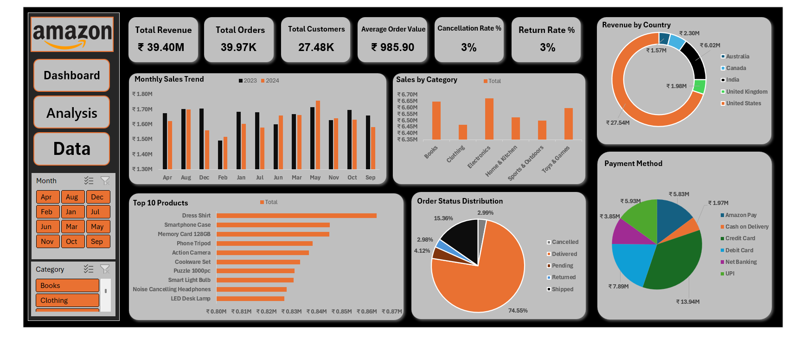

# Amazon Sales Analysis Dashboard

An interactive Excel dashboard for analyzing sales, orders, customers, products, and payment methods using a practice e-commerce dataset.

> **Data note:** This is a practice dataset, not official Amazon data. The metrics describe only the data included in this project.

## Dashboard Preview

## Raw Data Preview

## Project Overview

This workbook contains **39,966 order records** covering January 2023 to December 2024. It includes the raw data, supporting analysis, and an interactive dashboard with KPI cards, charts, and filters.

## Key Metrics

| Metric | Value |
|---|---:|
| Total Revenue | ₹39.40M |
| Total Orders | 39,966 |
| Total Customers | 27,484 |
| Average Order Value | ₹985.90 |
| Cancellation Rate | 2.99% |
| Return Rate | 2.98% |

## Analysis

- Monthly sales trends comparing 2023 and 2024
- Sales by product category
- Top 10 products by sales
- Order status distribution
- Revenue by country
- Payment method breakdown
- Interactive month and category filters

## Tools and Skills

- Microsoft Excel
- PivotTables and PivotCharts
- Slicers and interactive filtering
- KPI calculations
- Data visualization and dashboard design

## Workbook Sheets

- **Raw Data** — order-level records
- **Analysis** — supporting calculations and PivotTables
- **Dashboard** — KPI summary and interactive charts

## Metric Definitions

- **Total Revenue:** Sum of the `Total Amount` field.
- **Total Orders:** Count of order records.
- **Total Customers:** Distinct count of `CustomerID`.
- **Average Order Value:** Total revenue divided by total orders.
- **Cancellation Rate:** Cancelled orders divided by total orders.
- **Return Rate:** Returned orders divided by total orders.

## Project Files

[Download the Excel workbook](./Amazon%20Sales%20Analysis%20Dashboard.xlsx)

## How to Use

1. Download the Excel workbook from this repository.
2. Open it in Microsoft Excel.
3. Use the month and category slicers to explore the dashboard.
4. If you update the source data, select **Data → Refresh All**.

---
*Created as an Excel data analysis and dashboard portfolio project.*
